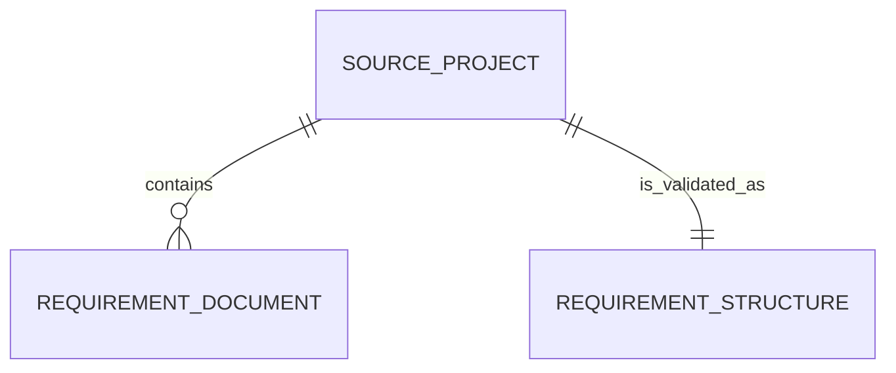

# Spec Validation Domain Model

This model describes the initial, read-only spec-structure validation
contract. It is independent of the command, transport, serialization, and
process-exit design.

## Use case: Spec Structure Validator

**Spec Structure Validator** is the use case. It accepts a Source Project,
reads its Requirement Documents, and returns one Spec Structure response. It
does not own or modify the source project or its documents.

The use case is valid only if every Requirement Document is valid. A
Requirement Document owns the invariants for its `Needs` and `Rationale`
fields; the use case aggregates those per-document outcomes into the
project-wide response.

## Entity relationship diagram

The relationships are read-only views of source-project content. Deleting,
moving, or changing a document while validation is in progress is outside this
initial contract; a later runtime contract must define how such input failures
are reported.

## Domain concepts

### Source Project

**Source Project** is the project selected by the caller-provided source
project path. Its identity is that supplied path for the lifetime of one
validation request. It contains zero or more Requirement Documents.

### Requirement Document

**Requirement Document** is the domain representation of one OFT item whose
identifier type is `req`, discovered in a requirements document in a Source
Project. Its identity is its OFT identifier. It has these read-only
attributes:

| Attribute | Type | Required | Invariant |
| --- | --- | --- | --- |
| `identifier` | OFT identifier | Yes | Its type is `req`. |
| `needs` | Text | Yes | It is not empty after trimming surrounding whitespace. |
| `rationale` | Text | Yes | It is not empty after trimming surrounding whitespace. |

An absent field, an empty field, and a whitespace-only field each violate the
corresponding Requirement Document invariant. This initial rule does not
validate the syntax or targets of a `Needs` value, nor the content of a
`Rationale` value beyond non-blankness. Document recognition, unsupported
formats, and filesystem failures are outside this structural-validation rule.

### Spec Structure

**Spec Structure** is the read-model response for one validation
request. It is immutable once returned and has one required attribute:

| Attribute | Type | Meaning |
| --- | --- | --- |
| `valid` | Boolean | `true` when every discovered Requirement Document satisfies both invariants; otherwise `false`. |

The response is derived rather than persisted. When no Requirement Document is
discovered, `valid` is `true`: no item violates either invariant.

## Use-case boundary

Spec Structure Validator accepts a Source Project and returns a Requirement
Structure. It does not expose mutable documents or requirements. Diagnostic
details, JSON representation, and process-exit behavior are intentionally not
part of this boundary.
