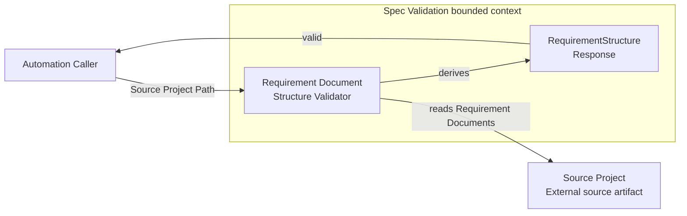

# Spec Validation Context and Scope

## Purpose

Spec Validation checks whether the OFT Requirement Documents discovered in a
supplied Source Project meet the declared structural rules.

## Bounded context

This bounded context owns the terms, domain model, rules, use case, and
RequirementStructure response documented in this directory. It reads source
artifacts but does not own, modify, or persist them.

## Context diagram

This diagram answers who interacts with Spec Validation and which request and
response cross its boundary.

Text alternative: an Automation Caller supplies a Source Project Path to Spec
Validation. The bounded context reads Requirement Documents from the external
Source Project and returns the `valid` value in a RequirementStructure response.

## Actor and input

An automation caller supplies a Source Project Path. The caller invokes the
Requirement Document Structure Validator use case and receives one immutable
RequirementStructure response.

## In scope

- Discovering Requirement Documents as the domain input to validation.
- Evaluating the non-blank Needs and Rationale invariants of each Requirement
  Document.
- Deriving `RequirementStructure.valid` from all discovered Requirement
  Documents.

## Out of scope

- CLI command names, transport, JSON serialization, and process-exit status.
- Filesystem accessibility, document-recognition policy, and parser behavior.
- Validation of `Needs` trace-target syntax or Rationale meaning.
- Running OFT or validating the completeness of an OFT graph.
- Modifying documents, hook configuration, CI configuration, or persistence.
