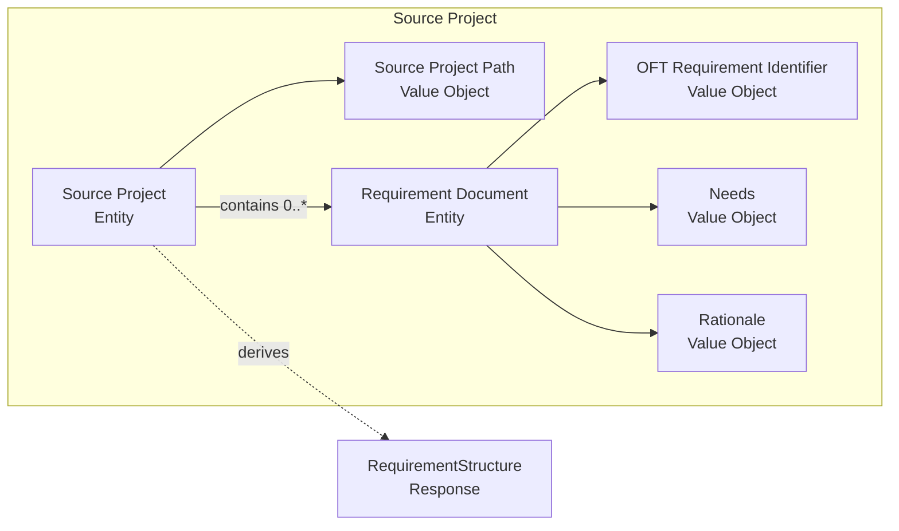
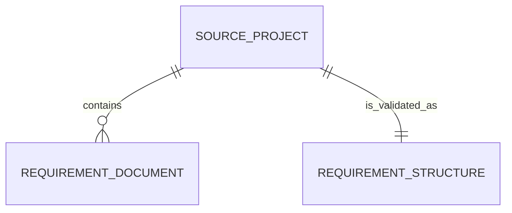

# Spec Validation Domain Model

This model describes the entities, relationships, and response model in the
read-only spec-structure validation contract. See
[context and scope](context_and_scope.md) for the boundary,
[value objects](value_objects.md) for immutable concepts, and
[invariants](invariants.md) for validation rules.

## Domain model diagram

This diagram answers how Source Project, Requirement Document, their value
objects, and the RequirementStructure response relate.

Text alternative: a Source Project has one Source Project Path and contains
zero or more Requirement Documents. Every Requirement Document has an OFT
Requirement Identifier, Needs, and Rationale value object. Validation derives
one RequirementStructure response from the Source Project.

## Entity relationship diagram

This diagram answers the cardinality of the Source Project relationships.

Text alternative: one Source Project contains zero or more Requirement
Documents and derives exactly one RequirementStructure response for a
validation request.

The relationships are read-only views of source-project content. Deleting,
moving, or changing a document while validation is in progress is outside this
contract; a runtime contract must define how such input failures are reported.

## Domain concepts

### Source Project

**Source Project** is the project selected by the caller-provided Source
Project Path. It contains zero or more Requirement Documents.

### Requirement Document

**Requirement Document** is the domain representation of one OFT item whose
identifier type is `req`, discovered in a requirements document in a Source
Project. Its identity is its OFT identifier. It has these read-only
attributes:

| Attribute | Type | Required | Invariant |
| --- | --- | --- | --- |
| `identifier` | OFT Requirement Identifier | Yes | Its type is `req`. |
| `needs` | Needs | Yes | It is non-blank. |
| `rationale` | Rationale | Yes | It is non-blank. |

Requirement Document validity is specified in
[invariants.md](invariants.md). The value-object representations are specified
in [value_objects.md](value_objects.md).

### Spec Structure

**Spec Structure** is the read-model response for one validation
request. It is immutable once returned and has one required attribute:

| Attribute | Type | Meaning |
| --- | --- | --- |
| `valid` | Boolean | `true` when every discovered Requirement Document satisfies both invariants; otherwise `false`. |

The response is derived rather than persisted. When no Requirement Document is
discovered, `valid` is `true`: no item violates either invariant.
