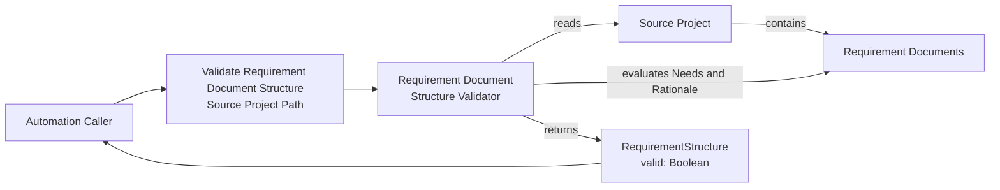

# Spec Validation Use Cases

## Requirement Document Structure Validator

An automation caller provides a source-project path. Requirement Document
Structure Validator discovers each Requirement Document in that project and
evaluates its `Needs` and `Rationale` value objects independently. It returns
one immutable `RequirementStructure` response.

The validation is valid only if all discovered Requirement Documents have both
fields present and non-blank after trimming surrounding whitespace. A missing,
empty, or whitespace-only field makes its Requirement Document invalid and
therefore makes the result invalid. If no Requirement Documents are present,
the result is valid because no item violates the rule.

The use case is specified by
`req~requirement-structure-validation~1`. It does not define a command name,
JSON serialization, diagnostics, filesystem-error handling, or exit status.
The use-case boundary is described in
[context_and_scope.md](context_and_scope.md); the deferred failure contract is
recorded in [failures.md](failures.md).

## Use-case flow diagram

## Acceptance scenarios

The canonical Gherkin scenarios are in
[scenarios.feature](../../scenarios/spec-validation/spec-structure-validation/requirement-document-structure-validator/scenarios.feature).

## Traceability handoff

The requirement declares `Needs: scn, impl, at`. These scenarios provide the
`scn` coverage. Implementation and acceptance-test evidence are deliberately
not added by this documentation-only issue and must be linked when the
corresponding work is authorized.
